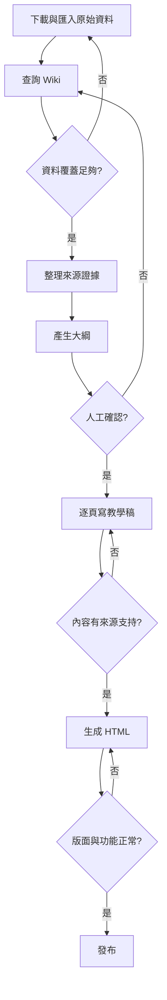

# Wiki → HTML 流程設計（預計）

## 必須實際檢查
- Coverage：每章都有相關資料支持，否則重新查詢。
- Faithfulness：每個技術重點可追溯原文，否則只重寫失敗頁。
- Rendering：手機／電腦排版、切頁按鈕及鍵盤操作要測試。

## 實際紀錄
尚未正式執行完整 loop；完成後於 `wiki/log.md` 填入真實結果。

## 第一次實際執行（2026-11-15）

- 已執行：Google 官網五篇教材正文閱讀 → 17 條證據卡 → 整理六個概念筆記 → 覆蓋率檢查。
- 覆蓋率發現：混合式推薦的詳細設計、冷啟動及過濾泡泡尚缺明確文獻對應。
- 已採取措施：在概念筆記標記資料不足，不讓這些主張直接進入簡報的「已證實事實」。
- 尚未執行：HTML 生成、內容逐頁忠實度檢查與瀏覽器渲染檢查。

## 教學品質回饋迴圈（2026-11-15）
使用者指出第 7 頁在沒有充分的測驗前複習下，直接要求辨識三種英文術語。這個問題在「教學性檢查」時本應被發現，因此將『測驗選項是否全是前面明確教過的同層級概念，以及測驗前是否提供足夠線索』加入**產生教學大綱後**的檢查項目，而不等到 HTML 做完才發現。修改第 7 頁，使用中文複習與兩選一情境題。
